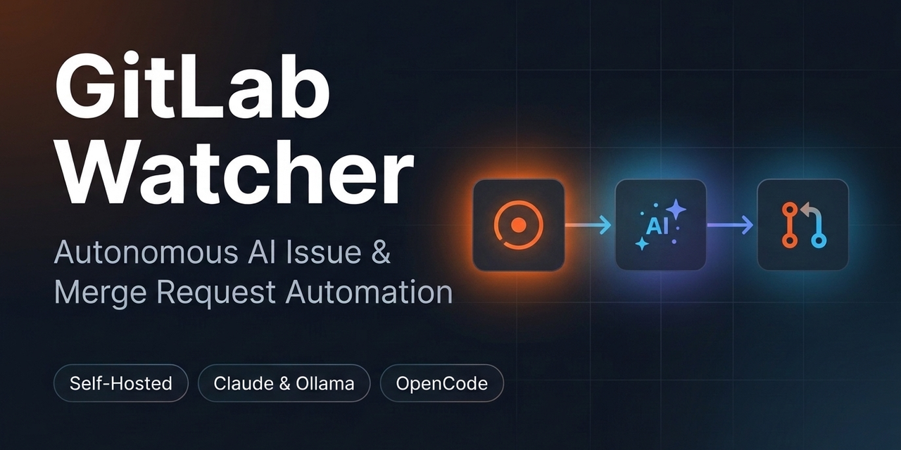
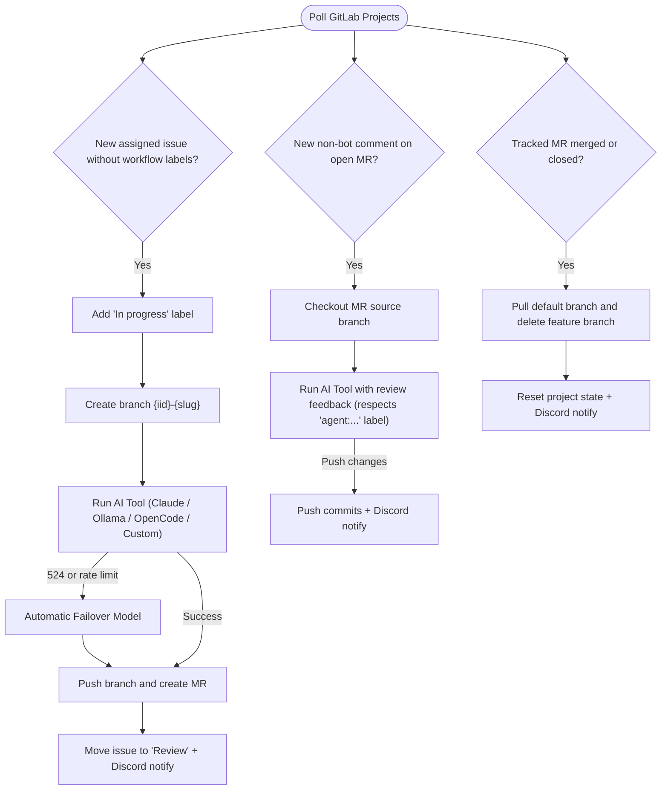

# GitLab Watcher — Autonomous AI Issue & Merge Request Automation

[](https://pypi.org/project/gitlab-watcher/)
[](https://github.com/gyengus/gitlab-watcher/actions/workflows/tests.yml)
[](https://codecov.io/gh/gyengus/gitlab-watcher)
[](https://github.com/gyengus/gitlab-watcher/actions/workflows/codeql.yml)
[](https://pypi.org/project/gitlab-watcher/)
[](LICENSE)

Self-hosted Python daemon that monitors your GitLab projects and autonomously resolves issues, addresses merge request review comments, and cleans up merged branches using **Claude CLI** (direct or via **Ollama**), **OpenCode**, or any custom AI coding agent.

## Key Benefits

- **Multi-Tool & Model Agnostic:** Works with Claude CLI (direct or launched via Ollama), OpenCode, or custom CLI wrappers.
- **Built-in Failover:** Automatically switches to your configured backup model on 524, timeout, or rate-limit errors.
- **Label-Driven Agent Routing:** Assign specialized AI agents per issue or merge request using GitLab labels (`agent:...`).
- **Security-First Design:** Never extracts tokens from git remotes, masks secrets in logs and Discord messages, enforces prompt sanitization, and isolates execution timeouts.
- **Zero-Touch Cleanup:** Automatically updates your default branch and deletes merged feature branches.

## Table of Contents

- [How It Works](#how-it-works)
- [Prerequisites](#prerequisites)
- [Installation](#installation)
- [Usage](#usage)
- [Configuration](#configuration)
- [AI Configuration & Failover](#ai-configuration--failover)
- [Supported AI Tools](#supported-ai-tools)
- [Troubleshooting](#troubleshooting)
- [Development & Contributing](#development--contributing)
- [Support & Donations](#support--donations)

## How It Works



### Issue Processing (Automatic)

When an issue is assigned to the configured user without workflow labels:

1. Adds "In progress" label
2. Creates branch `<issue-id>-<slug>` from default branch
3. Runs AI tool with the issue description (with automatic failover to backup models if primary fails)
4. Pushes changes and creates merge request
5. Moves issue to "Review" label
6. Sends optional Discord notification

### MR Comment Processing (Automatic)

When a new comment appears on an open MR (not from the bot user):

1. Checks out the MR's source branch
2. Runs AI tool with the comment as feedback
3. Pushes the changes to the remote branch
4. Notifies Discord channels about applied changes

### Post-Merge Cleanup (Automatic)

When an MR is merged:

1. Updates default branch (e.g., master/main)
2. Deletes the merged feature branch
3. Sends Discord notification to confirm cleanup

## Prerequisites

- **Python 3.11** or higher
- **Git** installed and available in your system path
- **GitLab Access Token** with API access
- **AI Tools**: Claude CLI (`claude`) or OpenCode (`opencode`) must be installed and available in your PATH. Note: Plugins that modify agent names (like `oh-my-opencode`) may cause issues in non-interactive background mode.

## Installation

```bash
# Recommended for CLI daemons (isolated environment)
pipx install gitlab-watcher

# Or install directly via pip
pip install gitlab-watcher
```

## Usage

```bash
# Run with default config (automatically starts the watcher)
gitlab-watcher

# Explicitly start the watcher
gitlab-watcher run

# Custom config file
gitlab-watcher -c /path/to/config.conf

# Synchronize local git state with remote (useful after manual intervention)
gitlab-watcher sync-state "Project Name"

# Verbose mode for debugging
gitlab-watcher --verbose
```

### CLI Error Handling & Diagnostics

The CLI provides clean, human-readable error messages for common configuration issues (such as missing files or invalid tokens) instead of raw Python tracebacks. Use the `--verbose` (`-v`) flag when you need full debug output.

## Configuration

Create the default configuration directory:

```bash
mkdir -p ~/.config/gitlab-watcher
```

Create `~/.config/gitlab-watcher/config.conf` with your environment details:

```bash
# Your GitLab instance URL (supports public domains and private/corporate IPs)
GITLAB_URL="https://git.example.com"

# Personal or Group Access Token (REQUIRED; supports standard and OIDC tokens with dots)
GITLAB_TOKEN="your_token_here"

# (Optional) Discord Webhook for detailed event notifications
DISCORD_WEBHOOK="https://discord.com/api/webhooks/your_webhook_id"

# Monitoring interval in seconds
POLL_INTERVAL=30

# AI Tool implementation style (ollama, direct, opencode, opencode-custom, custom)
AI_TOOL_MODE="ollama"

# Maximum execution time for AI tool in seconds (default: 3600 / 1 hour)
AI_TOOL_TIMEOUT=3600

# Working directory for state files and AI logs (default: /tmp/gitlab-watcher)
WORK_DIR="/tmp/gitlab-watcher"

# Path to log file (falls back to WORK_DIR/watcher.log if not writable)
LOG_FILE="/var/log/gitlab-watcher.log"

# LOG_LEVEL options: DEBUG, INFO, WARNING, ERROR, CRITICAL
LOG_LEVEL="INFO"

# Minimum GitLab access level to process MR comments (10=Guest, 20=Reporter, 30=Developer, 40=Maintainer, 50=Owner)
MIN_ACCESS_LEVEL=20

# List of absolute paths to project directories to monitor
PROJECT_DIRS=(
  "/path/to/project1"
  "/path/to/project2"
)
```

*(Note: If `GITLAB_URL` is not provided in the configuration, the watcher will attempt to extract it from your git remotes automatically. For security reasons, `GITLAB_TOKEN` is never extracted from git remotes and must be provided in the config file or via the `GITLAB_TOKEN` environment variable.)*

Command line `--verbose` or `-v` flags override `LOG_LEVEL` and force `DEBUG` level.

Each monitored project directory must have a `PROJECT.md`, `AGENTS.md`, or `CLAUDE.md` file with a corresponding Project ID:

```markdown
Project ID: 31
```

For the full configuration reference, architecture diagrams, and GitLab API details, see the [Detailed Documentation](docs/README.md).

## AI Configuration & Failover

### Automatic Failover Model Support

The watcher includes an automatic failover feature that switches to a backup AI model when the primary model encounters service issues (like 524 errors, rate limits, or service unavailability). This ensures continuous operation for hobby and production projects alike.

#### Configuration

Add the failover model to your `config.conf`:

```bash
# Primary AI tool mode
AI_TOOL_MODE="opencode"

# Optional: Failover model for service issues
AI_TOOL_FAILOVER_MODEL="provider/backup-model-name"

# Custom command with model placeholder support
AI_TOOL_CUSTOM_COMMAND="opencode run --model {model} --thinking --log-level debug {prompt}"
```

#### How Failover Works

1. **Primary Attempt**: Uses the configured AI tool with the default model
2. **Error Detection**: Automatically detects provider errors (524, rate limits, service unavailable, etc.)
3. **Failover Trigger**: On service errors, switches to the configured failover model
4. **Success Handling**: If failover succeeds, logs the success and continues processing
5. **Failure Handling**: If both models fail, sends Discord notification and waits for next cycle

#### Failover Support by Mode

| Mode | Model Support | Description |
|------|---------------|-------------|
| `ollama` | No | Model switching via CLI not supported |
| `direct` | No | Model switching via CLI not supported |
| `opencode` | Yes | Uses `--model` flag when specified |
| `opencode-custom` | Yes | Supports `{model}` placeholder substitution |
| `custom` | Yes | Supports `{model}` placeholder substitution |

**Important**: Leave `AI_TOOL_FAILOVER_MODEL` empty if you don't want failover functionality. The watcher will maintain backward compatibility with existing configurations.

### Recommended: Configure AI Coding Rules

For optimal AI-assisted development, configure AI coding rules at both global and project levels:

#### Global Rules (System-wide)
Create `~/.config/opencode/AGENTS.md` or `~/.claude/CLAUDE.md` with general coding guidelines that apply to all projects:

```markdown
# Global AI Rules

## Core Requirements
- Run tests after all code changes
- Use conventional commit messages (if applicable to your workflow)
- Follow security best practices
- Include proper error handling

## Testing Requirements
- Minimum 85% test coverage
- Fix any failing tests immediately
- Run `pytest` after completing any task
```

#### Project-specific Rules
Add `PROJECT.md`, `AGENTS.md`, or `CLAUDE.md` to your project directory for project-specific guidelines and project discovery (`Project ID`):

```markdown
# Project ID: 31

## AI Coding Rules
### Language Specific
- Java: Use `Objects.requireNonNull()` for null checks
- JavaScript: Use optional chaining (`?.`)

### Testing Requirements
- Run pytest after all code changes
- Maintain 90%+ test coverage

### Commit Guidelines
- Use clear, descriptive commit messages in English
```

#### How Rule Loading Works

1. **Automatic Rule Loading**: OpenCode automatically loads rules from:
   - Project `AGENTS.md` (preferred)
   - Project `CLAUDE.md` (fallback)
   - Global `~/.config/opencode/AGENTS.md`
   - Global `~/.claude/CLAUDE.md`

2. **Rule Priority**: Project-specific rules override global rules
3. **No Manual Configuration Required**: The GitLab Watcher automatically uses these rules when processing issues and MR comments

## Supported AI Tools

The watcher supports multiple AI tools:

| Mode | Description | Model Support |
|------|-------------|---------------|
| `ollama` | Launches Claude via Ollama (requires both `ollama` and `claude`) (default) | No |
| `direct` | Direct Claude CLI execution (`claude`) | No |
| `opencode` | Opencode CLI execution using `run` subcommand | Yes (`--model` flag) |
| `opencode-custom` | Custom OpenCode command template | Yes (`{model}` placeholder) |
| `custom` | Custom command for any AI tool | Yes (`{model}` placeholder) |

### Model Parameter Support

For `opencode`, `opencode-custom`, and `custom` modes, you can specify models dynamically:

```bash
# Opencode mode with model parameter
AI_TOOL_CUSTOM_COMMAND="opencode run --model {model} --thinking --log-level debug {prompt}"

# Custom command with model and working directory placeholders
AI_TOOL_CUSTOM_COMMAND="my-ai-tool --model {model} --prompt \"{prompt}\" --cwd {cwd}"
```

The `{model}` placeholder will be replaced with the specified model name, `{prompt}` with the issue description, and `{cwd}` with the working directory path.

Configure in `config.conf`:

```bash
AI_TOOL_MODE="ollama"  # or "direct", "opencode", "opencode-custom", "custom"
AI_TOOL_TIMEOUT=3600   # default is 1 hour
```

### Selecting OpenCode Agents via Labels

You can dynamically select which OpenCode agent should process a specific issue or merge request by using GitLab labels:

1. **Issue Labeling**: Assign a label in the format `agent:[Agent Name]` (or `agent-[Agent Name]`, e.g., `agent:Senior frontend developer`) to the issue.
2. **Mutual Exclusion**: If multiple agent labels are assigned, the watcher automatically retains the first one and removes the other redundant ones from the issue to ensure clarity.
3. **MR Label Inheritance**: When the watcher creates a Merge Request for the issue, it copies the selected agent label to the MR.
4. **Dynamic MR Comment Handling**: You can change the agent on the MR at any time (e.g. from `agent:Senior frontend developer` to `agent:Senior software testing expert`). The watcher will always use the agent currently labeled on the MR when processing new reviewer comments.
5. **Custom Commands**: You can use the `{agent}` placeholder in your custom command template (e.g., `AI_TOOL_CUSTOM_COMMAND="opencode run --agent {agent} {prompt}"`). If no agent label is present on the task, the placeholder evaluates to an empty string `""` and the watcher lets OpenCode default to its own configured agent.
6. **Discord Notifications**: The name of the selected agent is displayed in the Discord start notifications and comment processing messages.

### Timeout & Error Diagnostics

If an AI tool exceeds the configured `AI_TOOL_TIMEOUT` or fails with an error, the watcher will attempt to capture and display the partial output (`stdout`/`stderr`) generated before termination. These details are sent to Discord in a formatted code block and logged locally for troubleshooting.

## Troubleshooting

### "Default agent not found" (OpenCode)
If you are using `oh-my-opencode` or similar plugins that add hidden characters to agent names, OpenCode might fail to find the agent in non-interactive mode.
**Solution**: Define an explicit `default_agent` in your `~/.config/opencode/opencode.json` without hidden characters or special sorting prefixes.

### Discord Log Formatting
The watcher sanitizes output but preserves newlines for stack traces. If your Discord messages are too long, they will be automatically truncated to fit within Discord's 2000-character limit.

### Failover Model Issues
If the failover feature isn't working as expected:

1. **Enable Debug Logging**: Set `LOG_LEVEL="DEBUG"` to see detailed failover attempts
2. **Check Error Patterns**: The watcher only triggers failover on specific provider errors (524, rate limits, service unavailable, etc.)
3. **Verify Model Format**: Ensure the failover model name is correct and accessible via your AI tool
4. **Test Manually**: Try running the AI tool directly with the failover model to ensure it works

To test failover manually:
```bash
# Test with opencode mode
opencode run --model "<your-failover-model>" --thinking "test prompt"

# Test with custom command
opencode run --model "<your-failover-model>" --thinking --log-level debug {prompt}
```

## Development & Contributing

```bash
# Install dev dependencies
pip install -e ".[dev]"

# Run tests
pytest

# Run tests with coverage
pytest --cov=gitlab_watcher
```

For detailed development guidelines, testing requirements, and commit conventions, see [CONTRIBUTING.md](CONTRIBUTING.md) and the [Detailed Documentation](docs/README.md).

## Support & Donations

If you find this tool helpful and would like to support its continued development, crypto donations are very much appreciated!

- **Bitcoin (BTC):** `bc1qx4q5epl7nsyu9mum8edrvp2my8tut0enrz7kcn`
- **Dogecoin (DOGE):** `DS62HBswTfAJLadRcMyrUJq6CAE8XV6SqC`
- **EVM (ETH/BSC/Polygon):** `0x9F0a70A7306DF3fc072446cAF540F6766a4CC4E8`
- **Web3 Domain:** `gyengus.sendme1satoshi.wallet`

Thank you for your support!
